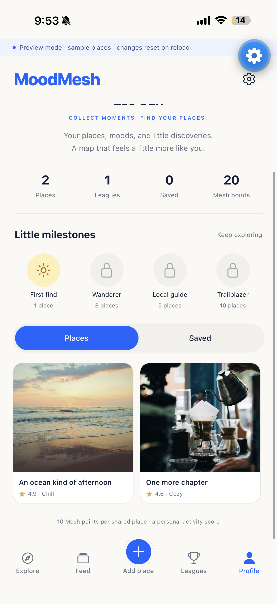
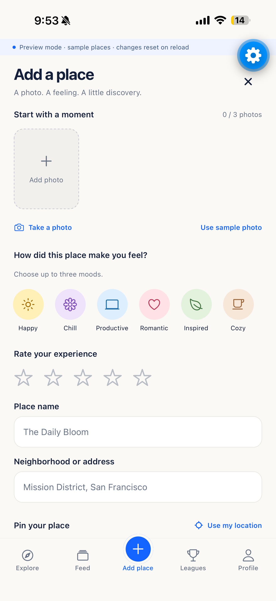
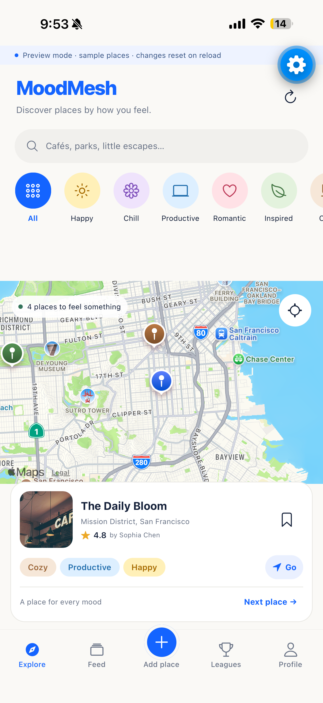

# MoodMesh

**Find places by how they make you feel.**

Most maps help you find a place. MoodMesh helps you find the right feeling. Explore a map of local discoveries, browse places tagged with moods like Cozy or Inspired, and share the moments that made a place worth remembering.

## See MoodMesh

| Explore the map                                                     | Share a place                                                           |
| ------------------------------------------------------------------- | ----------------------------------------------------------------------- |
|  |  |

| Take on a local challenge                                          | Keep track of your discoveries                                        |
| ------------------------------------------------------------------ | --------------------------------------------------------------------- |
|  |  |

## How it works

1. **Explore** the map and filter places by the mood you are looking for.
2. **Share** a place with photos, a rating, its location, and up to three moods.
3. **Save** places you want to come back to, and browse discoveries shared by others.
4. **Join a challenge** to find places around a theme and track your progress.

## Run the app

You need Node.js 22.13 or newer.

```sh
npm install
cp .env.example .env
npm start
```

The example environment file enables preview mode, which uses sample places and resets changes when the app reloads. To connect your own Appwrite project, set the Appwrite endpoint, project, database, collection, bucket, and function IDs in `.env`. Keep server API keys out of the app's environment.

To build and run the native app:

```sh
npx expo run:ios
# or
npx expo run:android
```

## Built with

Expo SDK 58, React Native, TypeScript, Expo Router, and Appwrite.
